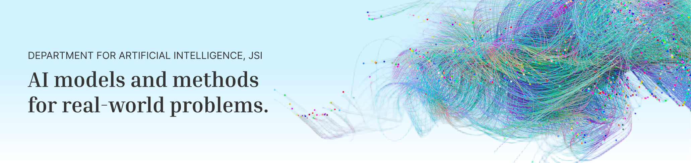

    
    
    
    

The **Department for Artificial Intelligence (E3)** at the [Jožef Stefan Institute](https://ijs.si/ijsw) in Ljubljana, Slovenia, develops AI models, methods and open-source tools for real-world problems. Our research covers **generative AI**, **language technologies**, **complex data analytics and visualisation**, and **modelling complex systems**.
